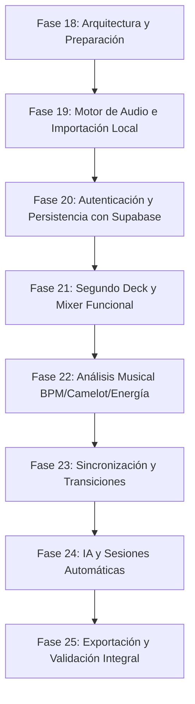

# FASE 18 — PREPARACIÓN DE ARQUITECTURA, CONFIGURACIONES E INTEGRACIÓN FUTURA DEL MOTOR DE AUDIO Y SUPABASE

**Fecha de ejecución:** 2026-10-15  
**Proyecto:** DESKTOP PROJECT — SYSTEM DJ (`dj_ai_web`)  
**Estado:** Diagnóstico y Arquitectura Completados — Listo para revisión e inicio de Fase 19  

---

## 1. Estado inicial del proyecto

El proyecto **SYSTEM DJ** es una aplicación web de escritorio inspirada en la potencia técnica de *rekordbox* y la experiencia visual moderna de *Spotify*. Al iniciar la Fase 18, el repositorio se encontraba en el siguiente estado verificado de forma directa:

1. **Línea base técnica:** El código fuente compila sin errores (`npx tsc -b --noEmit` y `npm run build`), el linter no reporta advertencias (`eslint .`), y las dependencias del `package.json` están sincronizadas con `package-lock.json`.
2. **Naturaleza del sistema:** La aplicación actual es un **prototipo visual interactivo de alta fidelidad con datos simulados** (`src/mock/*`). Cuenta con una estructura sólida de diseño, enrutamiento y cambio de idioma/tema en memoria, pero **carece de motor de audio real**:
   - No existe instancia de `AudioContext` ni nodos Web Audio API.
   - Los componentes de decks (`Deck.tsx`) y mixer (`MixerConsole.tsx`) manejan estados puramente visuales y desconectados entre sí.
   - La biblioteca (`Library.tsx`) y las listas (`Playlists.tsx`) consumen colecciones estáticas en memoria (`MOCK_LIBRARY`, `MOCK_PLAYLISTS`).
   - El reproductor inferior (`PlayerBar.tsx`) contiene pistas y tiempos hardcodeados sin reproducción sonora.
   - El script `test_api.py` en la raíz es una prueba aislada de Python con la SDK de Gemini, completamente desvinculada del frontend web.
   - No hay integración con backend ni base de datos remota.

---

## 2. Estructura y tecnologías verificadas

A través de la inspección directa del repositorio se constató la siguiente pila técnica:

- **Librería UI:** React 19 (`19.2.8`) y React DOM (`19.2.8`).
- **Lenguaje:** TypeScript (`~6.0.2` en bundler mode, target `ES2023`, `lib: ["ES2023", "DOM"]`).
- **Empaquetador y entorno de desarrollo:** Vite 8.3.0 (`@vitejs/plugin-react` 6.1.1).
- **Enrutamiento:** `react-router-dom` 7.18.4 configurado con `BrowserRouter` en `main.tsx` y 6 rutas activas en `App.tsx` (`/dashboard`, `/library`, `/playlists`, `/mixer`, `/settings`, `/profile`).
- **Iconografía:** `lucide-react` 1.52.0.
- **Utilidades de clase:** `clsx` 2.1.1.
- **Internacionalización:** `i18next` 26.4.2 y `react-i18next` 17.0.16 con soporte para Español (`es`, por defecto) e Inglés (`en`).
- **Linter y calidad de código:** ESLint v10 plano con `@eslint/js`, `typescript-eslint`, `eslint-plugin-react-hooks` y `eslint-plugin-react-refresh`.
- **Estructura de directorios verificada:**
  ```text
  dj_ai_web/
  ├── .agents/                    # Herramientas y bitácoras del entorno
  ├── .env.example                # Plantilla blindada de variables de entorno
  ├── docs/                       # Documentación técnica de arquitectura y fases
  ├── public/                     # Favicon y assets estáticos públicos
  ├── src/
  │   ├── assets/                 # Recursos gráficos (logos, hero)
  │   ├── components/
  │   │   ├── dj/                 # Componentes de cabina DJ (Deck, MixerConsole)
  │   │   └── ui/                 # Componentes atómicos reutilizables del Design System
  │   ├── i18n/                   # Configuración i18next y catálogos es/en
  │   ├── layouts/                # DesktopLayout, Header, Sidebar, PlayerBar
  │   ├── mock/                   # Mocks para biblioteca, listas, perfil y métricas
  │   ├── pages/                  # Vistas principales (Dashboard, Library, Playlists, Mixer, Settings, Profile)
  │   └── types/                  # Contratos de tipos de dominio (Track, Deck, Mixer, Audio, Database)
  ├── eslint.config.js
  ├── package.json
  ├── tsconfig.json
  └── vite.config.ts
  ```

---

## 3. Dependencias relevantes

### Dependencias de producción activas
- `react`, `react-dom` (`^19.2.8`): Núcleo reactivo de la aplicación.
- `react-router-dom` (`^7.18.4`): Navegación SPA fluida tipo aplicación de escritorio.
- `i18next`, `react-i18next` (`^26.4.2`, `^17.0.16`): Motor de traducción reactivo con cambio dinámico de idioma.
- `lucide-react` (`^1.52.0`): Iconografía coherente y liviana.
- `clsx` (`^2.1.1`): Composición condicional de clases CSS.

### Dependencias bajo evaluación especial
- `lamejs` (`^1.2.1`): Declarada en `package.json`, pero **sin ninguna importación en el código fuente**. Es una librería de codificación MP3 basada en CommonJS antiguo y sin tipos TypeScript. Para la Fase 25 (Exportación), se evaluará si se envuelve en un Web Worker dedicado o si se reemplaza por un codificador WebAssembly/WAV moderno que no bloquee el hilo de renderizado.
- `@supabase/supabase-js`: **No instalada aún**. Se definió arquitectónicamente el contrato y la integración de variables de entorno para que se instale ordenadamente en la **Fase 20**.

---

## 4. Arquitectura propuesta y justificación

Para garantizar que SYSTEM DJ soporte procesamiento de audio profesional en tiempo real sin congelar la interfaz ni comprometer la experiencia de usuario, se establece un patrón de **arquitectura desacoplada en capas**:

```text
┌────────────────────────────────────────────────────────────────────────┐
│                        CAPA DE PRESENTACIÓN (UI)                       │
│    React 19 Components (Deck, MixerConsole, Library, PlayerBar, etc.)  │
│        Consumen Hooks Reactivos (useDeck, useMixer, useLibrary)        │
└───────────────────────────────────┬────────────────────────────────────┘
                                    │ Eventos de usuario y suscripción de estado
                                    ▼
┌────────────────────────────────────────────────────────────────────────┐
│                    CAPA DE APLICACIÓN Y COORDINACIÓN                   │
│   Gestores de Estado de Dominio (Session / Decks / Mixer Coordinator)   │
│   Despacha comandos hacia el motor y emite estados estables a la UI   │
└──────────────┬──────────────────────────────────────────┬──────────────┘
               │                                          │
       Comandos de audio                          Persistencia / Auth
               ▼                                          ▼
┌──────────────────────────────┐          ┌──────────────────────────────┐
│     CAPA DE AUDIO REAL       │          │  CAPA DE DATOS Y SERVICIOS   │
│      (Web Audio API)         │          │                              │
│ • AudioContext Singleton     │          │ • IndexedDB (Archivos locales│
│ • DeckAudioGraph (A & B)     │          │   y metadatos en cliente)    │
│ • BiquadFilter (EQ & Filter) │          │ • Supabase Client (Auth,     │
│ • Analysers (VU / Waveforms) │          │   Perfiles, Playlists Cloud) │
│ • AudioBuffer in-memory      │          │ • Storage local (Tokens)     │
└──────────────────────────────┘          └──────────────────────────────┘
```

### Justificación técnica
1. **Separación de responsabilidades:** La interfaz React nunca debe contener instancias de `AudioContext`, manipular nodos Web Audio directamente ni almacenar buffers binarios pesados en el estado de componentes.
2. **Aislamiento de renderizado vs. audio:** El reloj de audio y los medidores VU operan a frecuencias de milisegundos o 60fps. Almacenar este flujo en `useState` provocaría re-renderizados descontrolados en React. La arquitectura desacoplada usa suscripciones de bajo costo para estados macro (Play/Pause, Track, Pitch) y canales de alta frecuencia (animación CSS / Canvas con `requestAnimationFrame`) para formas de onda y medidores.
3. **Privacidad y soberanía de datos:** Los archivos de audio permanecen 100% locales en el dispositivo del usuario; nunca se envían a servidores remotos.

---

## 5. Responsabilidades de los módulos

| Módulo / Directorio | Responsabilidad Principal | Regla de Aislamiento |
|---|---|---|
| `src/components/ui/` | Átomos visuales reutilizables (Button, Slider, Switch, Card, Badge, etc.). | Solo consumen tokens de `index.css`; no conocen el motor de audio ni la base de datos. |
| `src/components/dj/` | Controles especializados de cabina (Deck visual, Consola de mezcla, Sliders de pitch, Jog wheel). | Emiten eventos de interacción y reciben propiedades puras; delegan la reproducción a hooks. |
| `src/layouts/` | Estructura de ventana (Header, Sidebar, PlayerBar persistente inferior). | Mantiene la coherencia de marco de escritorio y navegación global. |
| `src/pages/` | Vistas principales (Dashboard, Library, Playlists, Mixer, Settings, Profile). | Ensamblan flujos de usuario integrando componentes UI y servicios. |
| `src/types/` | Contratos de dominio compartidos (`track.ts`, `deck.ts`, `mixer.ts`, `audio.ts`, `database.ts`). | Sin dependencias circulares ni lógica ejecutable; única fuente de verdad tipada. |
| `src/audio/` *(Fase 19)* | Motor de audio Web Audio API, grafos de nodos DSP, decodificador de buffers y cálculo de VU. | Totalmente agnóstico de React; no importa componentes ni JSX. |
| `src/services/` *(Fases 19-20)* | Persistencia local en IndexedDB y cliente Supabase (Auth, PostgreSQL con RLS). | Gestión de datos y sincronización; sin manipulación directa de audio. |

---

## 6. Modelo conceptual Track

Se superó la limitación del prototipo anterior (donde `duration` era un string y no existían estados de análisis ni referencias a archivos). Se formalizó el modelo en `src/types/track.ts`:

```typescript
export type MusicalKeyCamelot =
  | '1A' | '2A' | '3A' | '4A' | '5A' | '6A' | '7A' | '8A' | '9A' | '10A' | '11A' | '12A'
  | '1B' | '2B' | '3B' | '4B' | '5B' | '6B' | '7B' | '8B' | '9B' | '10B' | '11B' | '12B';

export type AnalysisStatus = 'pending' | 'analyzing' | 'analyzed' | 'failed' | 'unsupported';

export interface TrackAnalysis {
  status: AnalysisStatus;
  bpm?: number;
  key?: string;                     // Notación tradicional: ej. 'Am', 'F#m'
  camelot?: MusicalKeyCamelot;       // Notación armónica: ej. '8A', '11A'
  energy?: number;                   // Nivel de intensidad (0 a 10)
  waveformPeaks?: number[];          // Picos normalizados para visualización eficiente
  analysisError?: string;
}

export interface Track {
  id: string;
  title: string;
  artist: string;
  album?: string;
  duration: number;                  // Duración numérica en segundos (ej. 375.4)
  durationFormatted: string;         // Representación para interfaz (ej. "6:15")
  type: 'audio' | 'video';
  source: TrackAudioSource;          // Origen del archivo local
  analysis: TrackAnalysis;          // Metadatos calculados de forma determinista
  fileMeta?: TrackFileMetadata;      // Peso en bytes, mimeType, timestamp
  dateAdded: number;                 // Fecha de importación a la biblioteca
}
```

### Distinciones estrictas
- **Metadatos conocidos:** Título, artista, álbum y duración leídos de las cabeceras del archivo de audio al importarse.
- **Metadatos calculados (Análisis):** BPM, tonalidad Camelot y energía musical se mantienen como `undefined` con estado `pending` hasta que el motor de análisis los procese realmente. No se inventan valores ficticios para archivos locales.
- **Buffers de audio:** Los objetos pesados `AudioBuffer` **nunca** forman parte del objeto `Track`. Pertenecen exclusivamente al ciclo de vida en memoria de la tornamesa donde se cargue la pista.

---

## 7. Contratos propuestos para los Decks y el Mixer

Los contratos tipados fueron formalizados en `src/types/deck.ts` y `src/types/mixer.ts`:

### Contrato de Decks (`DeckState` y `DeckActions`)
- **Identificación:** `DeckId = 'A' | 'B'`.
- **Estados de transporte:** `'stopped' | 'playing' | 'paused' | 'loading' | 'error'`.
- **Control de pitch y tempo:** Rango estándar `±8%` (o configurable a `±16%` / `WIDE`), con cálculo dinámico del BPM efectivo y opción de *Key Lock* (Master Tempo) para preservar la tonalidad independientemente de la velocidad.
- **Punto CUE:** Posición en segundos memorizada para salto instantáneo y pre-escucha.
- **Sincronización:** Bandera `isSyncActive` para ajuste de tempo con respecto al deck opuesto.

### Contrato de Mixer (`MixerState` y `MixerActions`)
- **Tiras de canal (CH 1 / CH 2):**
  - `Gain / Trim`: Nivel de entrada (0 a 100, centro en 50 = ganancia unitaria).
  - `Ecualización de 3 bandas`: `high`, `mid`, `low` (-12dB de corte/realce, centro en 0dB).
  - `Filtro bipolar`: -100 (filtro paso bajo) a +100 (filtro paso alto), con centro en bypass (0).
  - `Fader de volumen`: Fader lineal de 0 a 100 por canal.
  - `Pre-escucha CUE PFL`: Envío independiente a auriculares.
- **Crossfader central:** Posición de 0 (100% Deck A) a 100 (100% Deck B), con curvas de atenuación seleccionables (`linear`, `constant-power` suave para mezclas largas, `cut` para scratch).
- **Master:** Control general de salida y medición de nivel.

---

## 8. Estrategia del motor de audio (Web Audio API)

El motor de audio se implementará a partir de la **Fase 19** con las siguientes directrices arquitectónicas:

### Ciclo de vida y Autoplay Policy
1. El `AudioContext` se creará mediante un patrón Singleton perezoso (*lazy singleton*).
2. De acuerdo con las políticas de autoplay de navegadores modernos (Chromium, Safari, Firefox), el contexto se iniciará en estado `'suspended'` y pasará a `'running'` mediante una llamada explícita a `await audioContext.resume()` durante la primera interacción directa del usuario (clic en Play, Cue o Carga de pista).
3. Si el dispositivo de salida de audio cambia o el contexto entra en estado `'interrupted'`, el motor expondrá el evento para notificar al usuario de forma no intrusiva.

### Cadena de procesamiento por Deck
Cada tornamesa cuenta con un grafo de nodos en cascada antes de converger en la salida maestra:

```text
[AudioBufferSourceNode] 
         │ (playbackRate según pitch)
         ▼
[BiquadFilterNode - Dual Isolator/Filter] (Paso bajo / Paso alto)
         │
         ▼
[BiquadFilterNode - High EQ] (Frecuencia de corte ~2.5 kHz)
         │
         ▼
[BiquadFilterNode - Mid EQ]  (Frecuencia central ~1.0 kHz, campana Q)
         │
         ▼
[BiquadFilterNode - Low EQ]  (Frecuencia de corte ~300 Hz)
         │
         ▼
[GainNode - Gain/Trim]       (Ajuste de ganancia de entrada)
         │
         ▼
[GainNode - Channel Fader]   (Fader de volumen de canal)
         │
         ▼
[GainNode - Crossfader Gain] (Atenuación según curva del crossfader)
         │
         ├─────────────────────────────────────────┐
         ▼                                         ▼
[GainNode - Master Output]                  [AnalyserNode - VU & Waveform]
         │                                  (Lectura FFT / RMS para medidores)
         ▼
[AudioContext.destination]
```

### Gestión de memoria y recursos
- Al decodificar un archivo con `audioContext.decodeAudioData()`, un archivo de 5 minutos en estéreo a 44.1 kHz consume aproximadamente 50 MB de memoria RAM en formato Float32.
- **Regla estricta:** Solo se mantienen decodificados en memoria los buffers correspondientes a las pistas activamente cargadas en **Deck A** y **Deck B**.
- Al cargar una nueva canción en un deck, el buffer anterior se desacopla inmediatamente para que el recolector de basura de JavaScript libere la memoria.

---

## 9. Estrategia de archivos locales y persistencia

### Aislamiento de canciones locales
**Los archivos de música del usuario no se suben a Supabase ni a servidores externos.** El procesamiento musical es 100% local.

### Capacidades del navegador y estrategia de acceso
1. **Importación universal:** Selección mediante `<input type="file" multiple accept="audio/*">` y soporte de arrastrar y soltar (*drag & drop*). Proporciona objetos `File` inmediatos para decodificación en la sesión actual.
2. **Limitación de seguridad de rutas web:** El sandbox de seguridad de los navegadores impide conocer o guardar rutas absolutas locales fijas como `C:\Musica\track.mp3` o `/home/usuario/Musica/track.mp3`. Un `URL.createObjectURL(file)` caduca al cerrar o recargar la pestaña.
3. **Estrategia de persistencia en IndexedDB:**
   - Para la biblioteca persistente, se empleará **IndexedDB**:
     - **Almacén de metadatos:** ID de pista, título, artista, BPM analizado, tono Camelot, duración, tamaño del archivo y hash de verificación.
     - **Almacén de audio / caché local:** Almacenamiento local del `Blob` binario dentro de IndexedDB (respaldado por la cuota de disco local del navegador, sin límites de 5 MB de `localStorage`). Esto permite que el usuario abra la aplicación al día siguiente y reproduzca sus canciones de inmediato sin necesidad de volver a cargarlas desde el explorador de archivos.
   - En navegadores Chromium que soporten **File System Access API** (`showOpenFilePicker`), se evaluará almacenar los identificadores `FileSystemFileHandle` solicitando revalidación de permisos de lectura cuando sea necesario.

### Clasificación de persistencia

| Tipo de Dato | Mecanismo de Almacenamiento | Persiste tras recargar | Sincronizable con Supabase |
|---|---|---|---|
| Preferencias UI (Tema claro/oscuro, Idioma) | `localStorage` | Sí | Sí (al iniciar sesión) |
| Parámetros de mixer (curva crossfader) | `localStorage` | Sí | Opcional |
| Metadatos de canciones locales | `IndexedDB` | Sí | Solo metadatos y playlists |
| Blobs de archivos de audio | `IndexedDB` (disco local del navegador) | Sí | **No** (estrictamente local) |
| Buffers de audio decodificados | Memoria RAM (`AudioBuffer`) | No (se regeneran al cargar) | **No** |
| Perfil de usuario y playlists remotas | Supabase (PostgreSQL) | Sí | Sí |

---

## 10. Plan de autenticación y datos con Supabase

### Aislamiento y alcance
Supabase se integrará a partir de la **Fase 20** con propósitos específicos de gestión de cuenta y sincronización de perfiles/playlists. La base de datos PostgreSQL **no interviene** en la reproducción ni decodificación del audio.

### Módulo cliente (`src/lib/supabase.ts`)
El cliente se configurará de forma defensiva para permitir que la aplicación funcione en **modo invitado / local** sin fallos si las variables no están configuradas:

```typescript
import { createClient } from '@supabase/supabase-js';

const supabaseUrl = import.meta.env.VITE_SUPABASE_URL;
const supabaseAnonKey = import.meta.env.VITE_SUPABASE_ANON_KEY;

export const supabase = (supabaseUrl && supabaseAnonKey)
  ? createClient(supabaseUrl, supabaseAnonKey)
  : null;

export const isSupabaseConfigured = (): boolean => Boolean(supabase);
```

### Esquema relacional en PostgreSQL (Planificado para Fase 20)
1. **`profiles`:** Asociado a `auth.users(id)`. Almacena nombre de DJ, biografía, avatar y estadísticas.
2. **`playlists`:** Colecciones de pistas creadas por el usuario con metadatos de sincronización.
3. **`playlist_tracks`:** Asociación ordenada de canciones (metadatos) dentro de una playlist.
4. **`user_preferences`:** Preferencias de interfaz (tema, idioma, ajustes por defecto de mixer).

### Políticas de seguridad (Row Level Security - RLS)
- RLS se activará obligatoriamente en todas las tablas desde el inicio:
  ```sql
  ALTER TABLE profiles ENABLE ROW LEVEL SECURITY;
  ALTER TABLE playlists ENABLE ROW LEVEL SECURITY;
  ALTER TABLE playlist_tracks ENABLE ROW LEVEL SECURITY;
  ALTER TABLE user_preferences ENABLE ROW LEVEL SECURITY;
  ```
- **Políticas estrictas:** Cada usuario únicamente podrá leer y escribir sus propios registros mediante `auth.uid() = user_id`. Las playlists marcadas como públicas podrán ser leídas por otros usuarios autenticados, pero nunca editadas.

---

## 11. Gestión de variables de entorno y seguridad

### Convención de Vite
- Todas las variables destinadas al frontend deben iniciar con el prefijo `VITE_` (`VITE_SUPABASE_URL`, `VITE_SUPABASE_ANON_KEY`).
- Variables que no comiencen con `VITE_` no serán empaquetadas en el código cliente de producción.

### Estado de `.env.example`
Se actualizó `.env.example` incorporando la estructura segura para el frontend y aislando variables de backend/scripts:
```env
# Supabase Client Configuration (Frontend Web / Vite)
VITE_SUPABASE_URL=https://your-project-id.supabase.co
VITE_SUPABASE_ANON_KEY=your-supabase-anon-key-here

# Gemini API configuration (Uso exclusivo en scripts locales / backend seguro)
GEMINI_API_KEY=your_gemini_api_key_here
```

### Reglas de seguridad confirmadas
1. **Claves de administrador:** Bajo ninguna circunstancia se debe incluir la clave `service_role` de Supabase en el repositorio ni en el cliente web.
2. **Protección Git:** El archivo `.gitignore` protege activamente `.env` y `.env.*`, manteniendo versionable únicamente `.env.example`.
3. **Inteligencia Artificial:** La variable `GEMINI_API_KEY` utilizada en `test_api.py` permanece aislada en local. No se expondrá en el frontend web. Si en la Fase 24 se integran funciones de recomendación inteligente, se canalizarán a través de un endpoint seguro (Supabase Edge Function o API proxy) sin exponer la clave en el navegador.

---

## 12. Compatibilidad con Design System, español/inglés y temas

### Design System (Tokens y Componentes)
- La aplicación cuenta con 89 tokens centralizados en `src/index.css`.
- Todas las futuras pantallas de importación de audio, modales de autenticación y controles de transporte reutilizarán obligatoriamente los componentes de `src/components/ui/` (`Button`, `Slider`, `Switch`, `Card`, `Badge`, `StateView`, `Input`, `Avatar`, `IconButton`).
- No se incorporarán estilos inline con colores hexadecimales fijos.

### Internacionalización (ES / EN)
- El catálogo de traducciones actual (`src/i18n/locales/{es,en}/translation.json`) cuenta con soporte para navegación, paneles DJ, mixer y biblioteca.
- Se planifica la expansión de claves para:
  - Mensajes de error y carga del motor de audio (`audio.decoding_error`, `audio.context_suspended`, `audio.unsupported_format`).
  - Diálogos de importación y biblioteca local (`library.import_prompt`, `library.drag_drop_zone`, `library.local_storage_notice`).
  - Formularios de autenticación Supabase (`auth.sign_in`, `auth.sign_up`, `auth.sign_out`, `auth.email_label`, `auth.password_label`).

### Temas claro y oscuro
- El conmutador de tema actual altera el atributo `data-theme` en `document.documentElement`.
- En la Fase 19/20, se añadirá persistencia en `localStorage` mediante un servicio/hook unificado para que la preferencia se mantenga al reiniciar la aplicación.

---

## 13. Archivos creados o modificados en la Fase 18

| Archivo | Tipo de Acción | Propósito técnico |
|---|---|---|
| `.env.example` | Modificado | Incorporación de variables de cliente Vite para Supabase (`VITE_SUPABASE_URL`, `VITE_SUPABASE_ANON_KEY`) y documentación de seguridad. |
| `src/types/track.ts` | Creado | Definición del modelo conceptual `Track`, estados de análisis, tonalidades Camelot y orígenes de audio local. |
| `src/types/deck.ts` | Creado | Contratos de estado y acciones de tornamesas digitales Deck A y Deck B (transporte, pitch, CUE, sync). |
| `src/types/mixer.ts` | Creado | Contratos para ecualización de 3 bandas, ganancia, faders de canal, crossfader y medidores VU. |
| `src/types/audio.ts` | Creado | Contratos de bajo nivel para el servicio Web Audio API, grafos de nodos y decodificación de buffers. |
| `src/types/database.ts` | Creado | Esquema de tipos TypeScript para perfiles, playlists y preferencias sincronizables en PostgreSQL bajo RLS. |
| `src/types/index.ts` | Creado | Punto de exportación centralizado de contratos de dominio. |
| `docs/FASE_18_ARQUITECTURA_Y_PREPARACION.md` | Creado | Documentación integral de diagnóstico, decisiones de diseño y plan de fases. |

---

## 14. Validaciones ejecutadas y resultados reales

Se ejecutaron las pruebas técnicas sobre el código y las nuevas definiciones:

| Comprobación | Comando ejecutado | Resultado real |
|---|---|---|
| **Verificación de tipos TypeScript** | `npx tsc -b --noEmit` | **0 errores**. Todos los nuevos contratos son 100% compatibles con la configuración estricta del proyecto. |
| **Linting estático** | `npm run lint` (`eslint .`) | **0 errores, 0 avisos**. Cumple con todas las reglas de ESLint v10, Hooks y Vite. |
| **Compilación de producción** | `npm run build` | **Compilación exitosa en 348 ms**. Bundle generado sin discrepancias en `dist/`. |
| **Seguridad de variables de entorno** | Inspección de `git status` y `.gitignore` | `.env` protegido correctamente. Solo `.env.example` contiene claves ficticias. |

---

## 15. Decisiones pendientes y limitaciones técnicas

1. **Persistencia de archivos de audio:**
   - La API de almacenamiento en `IndexedDB` con Blobs es completamente viable para un conjunto típico de mezclas (decenas o cientos de MBs), pero requiere monitoreo de cuota (`navigator.storage.estimate()`).
   - Para bibliotecas muy extensas de decenas de gigabytes, se priorizará la integración con `FileSystemFileHandle` donde esté soportada, o la recarga asistida por carpeta.
2. **Librería de exportación (`lamejs`):**
   - No se utilizará en el hilo principal de React. En la Fase 25 se evaluará encapsular la exportación en un Web Worker o adoptar un codificador basado en WebAssembly para evitar que la UI se congele durante el renderizado del archivo final.
3. **Persistencia inmediata de configuración:**
   - Actualmente el cambio de idioma y tema funciona en memoria; su persistencia en `localStorage` se conectará junto con los servicios locales en la siguiente fase.

---

## 16. Plan detallado de las siguientes fases



### Fase 19 — Motor de audio e importación local *(Siguiente paso recomendado)*
- Crear el servicio singleton `AudioEngineService` en `src/audio/`.
- Implementar la carga y decodificación de archivos de audio locales mediante Web Audio API (`decodeAudioData`).
- Conectar Deck A con reproducción real: Play, Pausa, Detención, Seek y visualización de tiempo transcurrido en tiempo real.
- Incorporar selector de archivos locales y zona de soltado (*drag & drop*) en la vista de biblioteca.
- Verificar con archivos MP3/WAV reales seleccionados por el usuario.

### Fase 20 — Autenticación y persistencia con Supabase
- Instalar `@supabase/supabase-js` y configurar el cliente defensivo en `src/lib/supabase.ts`.
- Diseñar e implementar formularios de Registro e Inicio de sesión integrados al Design System y compatibles con ambos temas.
- Configurar el esquema de PostgreSQL y activar políticas RLS para aislamiento de usuarios.
- Sincronizar perfiles y listas de reproducción del usuario.

### Fase 21 — Segundo deck y mixer funcional
- Integrar Deck B al motor de audio.
- Conectar los controles de ecualización (Hi, Mid, Low), Ganancia y Filtro al sonido real de cada canal mediante `BiquadFilterNode`.
- Conectar el crossfader con cálculo de curva real entre Deck A y Deck B.
- Conectar los medidores VU a partir de datos reales de `AnalyserNode`.

### Fase 22 — Análisis musical
- Implementar algoritmo de detección de BPM en segundo plano mediante análisis de picos y autocorrelación de energía.
- Implementar detección de tonalidad armónica y mapeo al sistema Camelot.
- Procesar formas de onda detalladas para los decks sin bloquear la interfaz.

### Fase 23 — Sincronización y transiciones
- Implementar función SYNC para igualar BPMs y alinear fases de beat entre Deck A y Deck B.
- Añadir controles de bend (+/- tempo provisional) y saltos a puntos CUE.

### Fase 24 — IA y sesiones automáticas
- Evaluar proveedor y latencia para recomendaciones de canciones y secuenciación armónica.
- Aislar el consumo mediante backend o Supabase Edge Functions con cuotas controladas.

### Fase 25 — Exportación y validación integral
- Implementar grabación de la mezcla de salida mediante `MediaStreamAudioDestinationNode` u `OfflineAudioContext`.
- Exportar la sesión a WAV/MP3 mediante un Web Worker dedicado.
- Pruebas integrales de rendimiento, audio sin distorsión (*clipping*) y validación final de la aplicación.
