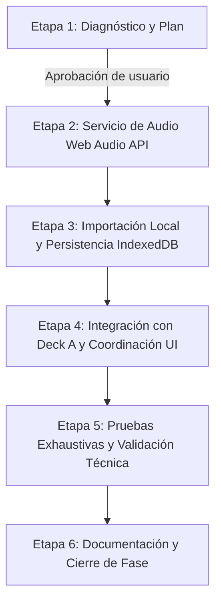

# PLAN DE IMPLEMENTACIÓN — FASE 19: MOTOR DE AUDIO REAL E IMPORTACIÓN LOCAL

**Proyecto:** DESKTOP PROJECT — SYSTEM DJ (`dj_ai_web`)  
**Fecha:** 2026-10-15  
**Estado:** Diagnóstico y Planificación Completados — Pendiente de Aprobación para Etapa 2  

---

## 1. Diagnóstico del Estado Actual

### 1.1 Inspección de componentes de reproducción

| Componente | Archivo | Estado Actual | Comportamiento Actual |
|---|---|---|---|
| **Deck** | `src/components/dj/Deck.tsx` | Simulado | Posee estado local con `useState(false)` para `isPlaying` y `useState(50)` para `pitch`. El botón de Play solo conmuta una bandera visual; el Jog Wheel gira con una clase CSS (`playing-anim-spin`); la forma de onda es un div estático con animación CSS (`playing-anim-wave`). `timeRemaining` es una propiedad estática recibida como texto (ej. `"-4:20"`). Los botones CUE y SYNC no ejecutan ninguna acción. |
| **Library** | `src/pages/Library.tsx` | Simulado | Renderiza una lista estática en memoria proveniente de `src/mock/library.ts` (`MOCK_LIBRARY`). El buscador y los filtros operan localmente en memoria. El botón de reproducción en cada fila (`IconButton` con icono `Play`) no posee manejador de eventos `onClick`. No existe selector de archivos locales (`<input type="file">`), zona de arrastre (*drag & drop*) ni opción para cargar pistas en los decks. |
| **PlayerBar** | `src/layouts/PlayerBar.tsx` | Simulado | Barra inferior persistente en toda la aplicación (`DesktopLayout`). Muestra datos fijos de *"Strobe (Club Edit)"* por *deadmau5* con tiempos `2:11 / 6:15` y progreso `35%`. `isPlaying`, volumen y mute son variables reactivas locales desconectadas de cualquier contexto o elemento de audio. |
| **Mixer** | `src/pages/Mixer.tsx` | Simulado | Instancia `Deck A` con `MOCK_LIBRARY[0]` y `Deck B` con `MOCK_LIBRARY[1]`. No existe coordinación de estado ni canal de comunicación entre `Mixer.tsx` y `Library.tsx` o `PlayerBar.tsx`. |
| **MixerConsole** | `src/components/dj/MixerConsole.tsx` | Simulado | Sliders de EQ, ganancia, fader y crossfader manejan valores numéricos en memoria sin procesar audio. El medidor VU ejecuta un temporizador `setInterval` cada 150 ms que genera números pseudoaleatorios con `Math.random()`. |

### 1.2 Examen de contratos de tipos (`src/types/`)

- **`src/types/track.ts`:**
  - Define la entidad `Track` moderna con duración numérica en segundos (`duration: number`), representación legible (`durationFormatted: string`), discriminador de fuente (`source: TrackAudioSource` con `type: 'file' | 'blob' | 'indexeddb' | 'url'`), y análisis musical (`analysis: TrackAnalysis`).
  - **Hallazgo clave:** En `src/mock/library.ts` existe una interfaz homónima `Track` en desuso con `duration: string` y propiedades planas (`bpm: number; key: string; energy: number;`). Para la Fase 19, la biblioteca real debe adoptar exclusivamente el contrato centralizado de `src/types/track.ts`.
- **`src/types/audio.ts`:**
  - Formaliza `IAudioEngineService` con firmas completas para inicialización (`initialize`, `resume`), gestión de buffers (`decodeAudioData`, `loadBufferToDeck`, `unloadDeck`), transporte (`playDeck`, `pauseDeck`, `stopDeck`, `seekDeck`, `setDeckPlaybackRate`) y telemetría (`getDeckCurrentTime`, `getDeckDuration`).
  - Formaliza `DeckAudioGraph` para instanciar la cadena de nodos DSP (`AudioBufferSourceNode`, `BiquadFilterNode`, `GainNode`, `AnalyserNode`).
- **`src/types/deck.ts`:**
  - Define `DeckState` (`deckId`, `track`, `playbackState: 'stopped' | 'playing' | 'paused' | 'loading' | 'error'`, `currentTime`, `duration`, `pitch`, `calculatedBpm`, `cuePoint`) y `DeckActions`.

### 1.3 Almacenamiento actual de canciones de prueba

Actualmente las canciones residen en colecciones estáticas en memoria:
- `src/mock/library.ts`: Array `MOCK_LIBRARY` con 10 registros ficticios.
- `src/mock/dashboard.ts`: `MOCK_RECENT_TRACKS` y `MOCK_RECOMMENDATIONS`.
- `src/mock/playlists.ts`: `MOCK_PLAYLISTS`.

Ninguno de estos archivos almacena datos binarios ni URLs de audio reales.

### 1.4 Comunicación actual entre la Biblioteca y el Deck A

**Diagnóstico:** En el estado actual **no existe comunicación alguna** entre `Library.tsx` y `Deck A` (`Mixer.tsx`).
- `Library.tsx` y `Mixer.tsx` son rutas independientes (`/library` y `/mixer`) controladas por `react-router-dom`.
- Los directorios `src/store/` y `src/hooks/` se encuentran actualmente vacíos.
- Se requiere un mecanismo desacoplado de estado compartido (un hook/store de sesión DJ, ej. `useDeckStore` o `DJSessionContext`) que mantenga la pista cargada en Deck A accesible independientemente de la página en la que navegue el usuario.

### 1.5 Design System, traducciones y validación técnica

- **Design System:** Cuenta con 89 tokens CSS centralizados en `src/index.css`. Todos los nuevos elementos (botones de importación, zona de soltado, selector de archivos y alertas de formato) utilizarán los componentes existentes de `src/components/ui/` (`Button`, `Card`, `IconButton`, `Input`, `Slider`, `Badge`, `StateView`).
- **Internacionalización:** Existen catálogos en `src/i18n/locales/es/translation.json` y `en/translation.json`. Se incorporarán nuevas claves para importación de audio, advertencias de formato y estados de transporte.
- **Validaciones verificadas:**
  - `npx tsc -b --noEmit`: 0 errores.
  - `npm run lint`: 0 advertencias/errores.
  - `npm run build`: Compilación limpia en ~340 ms.

---

## 2. Clasificación de Funcionalidades: Reutilizables vs. Simuladas

| Módulo / Funcionalidad | Clasificación | Plan de Tratamiento en Fase 19 |
|---|---|---|
| **Estructura visual de Deck.tsx** | Reutilizable | Se mantiene íntegramente la maqueta visual, jog wheel, sliders y distribución espacial. |
| **Play / Pause en Deck A** | Simulado -> **Real** | Se conecta directamente al método `playDeck` / `pauseDeck` del `AudioEngineService`. |
| **Stop en Deck A** | Inexistente -> **Real** | Se agrega acción de Stop que detiene el audio y rebobina la posición a `0:00`. |
| **Tiempo transcurrido y duración en Deck A** | Simulado -> **Real** | Se sustituye el texto hardcodeado por la lectura de tiempo del motor de audio vía `requestAnimationFrame`. |
| **Búsqueda temporal (Seek)** | Simulado -> **Real** | Se habilita la navegación temporal sobre la forma de onda / barra de progreso del deck. |
| **Jog Wheel animación** | Reutilizable | Continúa girando sincronizado con el estado `isPlaying` real del motor. |
| **Pitch Slider** | Simulado -> **Real** | Modifica dinámicamente el `playbackRate` del `AudioBufferSourceNode` en tiempo real (`±8%`). |
| **BPM y Detección de Tonalidad (Key)** | Simulado -> **Pendiente (Fase 22)** | En canciones locales importadas se mostrará como `"--"` o `"Pendiente"`, evitando números inventados. |
| **Botones CUE y SYNC** | Simulado -> **Pendiente (Fases 21/23)** | Permanecen visibles con indicación de funcionalidad en desarrollo. |
| **Deck B y Mixer Console** | Simulado -> **Pendiente (Fase 21)** | Se mantienen visualmente activos sin interferir con la reproducción real del Deck A. |
| **Importación de archivos locales** | Inexistente -> **Real** | Se añade selector de archivos y drag & drop compatible con MP3 y WAV. |
| **Persistencia de audio local** | Inexistente -> **Real** | Se integra almacenamiento local en IndexedDB para blobs y metadatos sin subir a servidores. |

---

## 3. Arquitectura del Motor de Audio y Ciclo de Vida

### 3.1 Servicio Desacoplado: `AudioEngineService` (`src/audio/AudioEngineService.ts`)

Para cumplir con la directriz de desacoplamiento estricto de React, el servicio operará como una clase TypeScript pura independiente de componentes o hooks:

```text
┌────────────────────────────────────────────────────────┐
│                   AudioEngineService                   │
│                                                        │
│  • AudioContext (Singleton perezoso)                   │
│  • DeckAudioGraph para Deck A (y placeholder Deck B)   │
│  • Offsets de tiempo precisos (audioContext.currentTime│
│  • Decodificación mediante audioContext.decodeAudioData │
└───────────────────────────┬────────────────────────────┘
                            │
               ┌────────────┴────────────┐
               ▼                         ▼
    ┌──────────────────────┐  ┌──────────────────────┐
    │   Transport Control  │  │   Resource Lifecycle │
    │ • playDeck(A, offset)│  │ • unloadDeck(A)      │
    │ • pauseDeck(A)       │  │ • disconnect nodes   │
    │ • stopDeck(A)        │  │ • gc-friendly buffer │
    │ • seekDeck(A, sec)   │  │ • resume on click    │
    └──────────────────────┘  └──────────────────────┘
```

### 3.2 Gestión del Autoplay y Estados del `AudioContext`
1. **Creación perezosa:** El `AudioContext` no se instancia inmediatamente al importar el módulo, sino al primer llamado a `initialize()` o `resume()`.
2. **Desbloqueo reactivo:** Si el navegador bloquea la reproducción y coloca el contexto en `'suspended'`, cualquier acción del usuario (clic en "Cargar en Deck A", clic en "Play", selección de archivo) ejecuta `await audioEngine.resume()`.
3. **Manejo de interrupciones:** El servicio escucha el evento `audioContext.onstatechange` para alertar si el hardware de sonido cambia o entra en suspensión.

### 3.3 Cadena de procesamiento del Deck A
```text
[AudioBufferSourceNode] (nuevo por cada reproducción tras pause/stop)
         │  playbackRate.value = 1.0 + (pitch / 100 * 0.16)
         ▼
[BiquadFilterNode] (EQ bypass / centro en 0 dB en esta fase)
         │
         ▼
[GainNode - Channel Volume] (1.0 por defecto)
         │
         ▼
[GainNode - Master Volume]  (1.0 por defecto)
         │
         ▼
[AudioContext.destination]
```

### 3.4 Precisión temporal y fuente de verdad
- `AudioBufferSourceNode` en Web Audio API es de **un solo uso**: una vez detenido con `.stop()`, no puede reiniciarse.
- Para simular pausa y reanudación exactas:
  - Al reproducir: se crea un nuevo `AudioBufferSourceNode`, se conecta al grafo, y se inicia con `sourceNode.start(0, startOffset)`. Se registra el `startedAt = audioContext.currentTime`.
  - Al pausar: se calcula `pausedAt = currentOffset + (audioContext.currentTime - startedAt) * playbackRate`. Se detiene el nodo y se guarda la posición.
  - Al detener (stop): se cancela el nodo y `pausedAt = 0`.
  - Al buscar (seek): si está sonando, se reinicia el nodo en la nueva posición; si está pausado, se actualiza `pausedAt`.

---

## 4. Estrategia de Importación Local y Persistencia

### 4.1 Selección y Drag & Drop
1. **Selector local:** Botón en `Library.tsx` que dispara un `<input type="file" multiple accept="audio/mpeg,audio/wav,audio/mp3">` invisible.
2. **Zona de soltado (Drag & Drop):** Zona visual interactiva en la cabecera o cuerpo de la biblioteca con retroalimentación visual al arrastrar (`isDragging`).
3. **Validación de formato:** Comprobación estricta de extensiones (`.mp3`, `.wav`) y tipos MIME (`audio/mpeg`, `audio/mp3`, `audio/wav`, `audio/wave`, `audio/x-wav`). Archivos no compatibles se descartan con un mensaje de advertencia amigable sin interrumpir el resto de la lista.

### 4.2 Persistencia en IndexedDB (`src/services/storage/IndexedDBStorage.ts`)
- **Justificación:** Los navegadores revocan los `Blob URL` (`URL.createObjectURL`) al recargar la página y no permiten acceder a rutas de archivos del sistema por motivos de seguridad.
- **Implementación:**
  - Base de datos: `SystemDJ_Storage` (versión 1).
  - Object Store: `tracks` (almacena el `Track` con metadatos y el objeto binario `blob` / `file`).
  - Al reiniciar la aplicación, la biblioteca lee automáticamente los metadatos y blobs guardados en IndexedDB, permitiendo cargar y escuchar canciones de sesiones anteriores sin volver a seleccionarlas del disco.
  - Si la cuota de IndexedDB se excede (`QuotaExceededError`), se retiene la pista exclusivamente en la memoria de la sesión actual y se notifica al usuario.

---

## 5. Integración con Deck A y Coordinación de Estado

### 5.1 Coordinación de Sesión (`src/store/useDJStore.ts` o Contexto)
Para conectar la biblioteca (`/library`) con el Deck A (`/mixer`):
1. **Estado centralizado de transporte:**
   - `deckA`: Estado reactivo (`track`, `playbackState`, `currentTime`, `duration`, `pitch`, `calculatedBpm`, `errorMessage`).
   - `libraryTracks`: Lista unificada de pistas importadas en local + canciones mock de demostración.
2. **Acciones de transporte disponibles:**
   - `loadTrackToDeckA(track: Track)`: Decodifica el archivo binario mediante `AudioEngineService.decodeAudioData()`, carga el buffer en Deck A y actualiza el estado a `'stopped'` con la duración real.
   - `playDeckA()`: Reanuda `AudioContext` y comienza la reproducción.
   - `pauseDeckA()`: Detiene la reproducción conservando el segundo exacto.
   - `stopDeckA()`: Detiene y rebobina a `0:00`.
   - `seekDeckA(seconds: number)`: Desplaza la posición de reproducción.
   - `setPitchDeckA(pitch: number)`: Ajusta la velocidad de reproducción.

### 5.2 Modificaciones en `Deck.tsx`
- Se adapta para aceptar propiedades de control o conectarse al store de Deck A.
- Se añade botón de **STOP** o comportamiento CUE/STOP nativo.
- Se reemplaza el tiempo estático por el tiempo actual y tiempo restante reales formateados (`mm:ss`).
- Se añade barra interactiva de progreso temporal para búsqueda (*seek*).
- Se muestra un indicador de estado claro durante la decodificación (`loading` / spinner discreto) o en caso de error de archivo.

---

## 6. Manejo de Errores y Liberación de Recursos

### 6.1 Errores contemplados
1. **Formato no admitido:** Detección en el cliente antes de la lectura. Mensaje en UI: *"El formato del archivo no es compatible. Solo se admiten archivos MP3 y WAV."*
2. **Archivo dañado o corrupto:** Captura del rechazo de `audioContext.decodeAudioData()`. Estado del Deck pasa a `'error'` y se emite mensaje: *"No se pudo decodificar el archivo de audio. El archivo podría estar dañado."*
3. **Autoplay denegado por el navegador:** Reintento automático invocando `audioContext.resume()` ante la primera pulsación de cualquier botón de la interfaz.

### 6.2 Prevención de fugas de memoria (Memory Leaks)
- **Desconexión de nodos:** Antes de crear un nuevo `AudioBufferSourceNode`, se llama a `.stop()`, `.disconnect()` y se limpia la referencia anterior.
- **Liberación de AudioBuffer:** Solo Deck A retiene su buffer activo en memoria. Si se carga una nueva pista, la referencia anterior se anula (`buffer = null`) permitiendo al Garbage Collector recuperar los ~50 MB de memoria RAM asignada al buffer Float32.
- **Temporizadores y RAF:** El seguimiento del tiempo transcurrido para la interfaz se gobernará mediante `requestAnimationFrame` que se desactiva inmediatamente cuando el audio entra en pausa o se detiene.

---

## 7. Archivos Afectados

### Archivos a Crear
1. `src/audio/AudioEngineService.ts`: Servicio del motor Web Audio API desacoplado de React.
2. `src/services/storage/IndexedDBStorage.ts`: Gestor de persistencia local en IndexedDB para blobs y metadatos.
3. `src/store/useDJStore.ts`: Coordinador reactivo de estado para los Decks y la Biblioteca.
4. `src/utils/formatters.ts`: Utilidades para formateo de tiempos (`formatDuration(seconds)`) y tamaños (`formatBytes(bytes)`).
5. `src/utils/audioValidation.ts`: Validadores de archivos (MIME, extensión y decodificabilidad).
6. `docs/FASE_19_MOTOR_AUDIO_E_IMPORTACION.md`: Informe final de la fase (al cierre).

### Archivos a Modificar
1. `src/pages/Library.tsx`: Integración del selector de archivos, drag & drop, lista reactiva de canciones importadas y acción "Cargar en Deck A".
2. `src/pages/Library.css`: Estilos para la zona de arrastre e indicador de pistas locales importadas.
3. `src/components/dj/Deck.tsx`: Integración con controles reales de transporte (Play, Pause, Stop, Seek, Pitch), visualización de tiempo real y estados de carga.
4. `src/components/dj/Deck.css`: Estilos para barra de progreso/seek y botón Stop.
5. `src/pages/Mixer.tsx`: Conexión de Deck A al estado compartido de reproducción.
6. `src/i18n/locales/es/translation.json` y `en/translation.json`: Nuevas cadenas para importación, advertencias de formato y estados de transporte.

---

## 8. Criterios de Aceptación

1. **Importación Local Funcional:**
   - El usuario puede importar archivos locales MP3 y WAV mediante selector nativo o arrastrar y soltar.
   - Los archivos importados aparecen inmediatamente en la tabla de la biblioteca con su nombre, tamaño y fecha.
   - Los archivos y metadatos se guardan en IndexedDB y persisten al recargar la aplicación en el navegador.
   - Ningún archivo se envía a servidores remotos ni a Supabase.
2. **Carga en Deck A:**
   - La biblioteca ofrece la opción de cargar una canción en Deck A.
   - Al cargarla, se decodifica en un `AudioBuffer` en memoria y se extrae la duración real exacta.
   - La interfaz muestra el título, artista o nombre del archivo y la duración real en Deck A.
3. **Reproducción Real Web Audio API:**
   - Al presionar **PLAY**, el audio suena a través de los altavoces/auriculares del sistema.
   - El botón alterna a **PAUSE**; al pulsarlo, el sonido cesa inmediatamente y la posición se memoriza.
   - Al presionar **PLAY** nuevamente, la reproducción continúa con fluidez desde el punto pausado.
   - La acción de **STOP** detiene el audio y restablece el cursor y tiempo transcurrido a `0:00`.
   - La acción de **SEEK** permite saltar a cualquier punto de la pista y reanudar o permanecer en pausa en esa posición.
   - El slider de **PITCH** altera en tiempo real la velocidad de reproducción (`playbackRate`) dentro del rango `±8%`.
4. **Resiliencia y Calidad:**
   - Archivos con formatos no admitidos o corruptos son rechazados mostrando mensajes de advertencia claros sin congelar la app.
   - Al cambiar de canción o detenerla, los nodos de audio anteriores se desconectan sin fugas de memoria.
   - `npx tsc -b --noEmit`, `npm run lint` y `npm run build` ejecutan con 0 errores y 0 advertencias.
   - Todo el flujo cuenta con traducciones completas en español e inglés y es compatible con el tema claro y oscuro.

---

## 9. Orden de Trabajo por Etapas



1. **Etapa 1 — Diagnóstico y Plan:** *(Actual - Esperando aprobación)*
   - Entrega de `docs/PLAN_FASE_19.md` y presentación del diagnóstico.
2. **Etapa 2 — Servicio de Audio:**
   - Crear `src/audio/AudioEngineService.ts`.
   - Implementar gestión segura de `AudioContext`, decodificación de `ArrayBuffer`, transporte (play, pause, stop, seek, pitch) y telemetría de tiempo.
   - Validación y pruebas unitarias/de servicio.
3. **Etapa 3 — Importación de Archivos Locales:**
   - Crear `src/services/storage/IndexedDBStorage.ts` y utilidades de validación.
   - Integrar en `Library.tsx` selector de archivos, zona drag & drop y visualización de pistas locales.
   - Agregar botón/acción "Cargar en Deck A".
4. **Etapa 4 — Integración con Deck A:**
   - Crear store/coordinador `useDJStore.ts` para comunicar biblioteca y decks.
   - Conectar `Deck.tsx` en `Mixer.tsx` al servicio de audio real para Deck A.
   - Conectar Play, Pause, Stop, Seek, Pitch y tiempos reales en la interfaz.
   - Mantener controles pendientes claramente identificados.
5. **Etapa 5 — Pruebas y Validación:**
   - Ejecutar `tsc`, `lint` y `build`.
   - Pruebas manuales con archivos MP3 y WAV reales.
   - Pruebas de borde: archivos dañados, cambios de pista sucesivos, modo claro/oscuro, español/inglés.
6. **Etapa 6 — Documentación y Cierre:**
   - Elaborar `docs/FASE_19_MOTOR_AUDIO_E_IMPORTACION.md` con todos los resultados técnicos y commits realizados.
